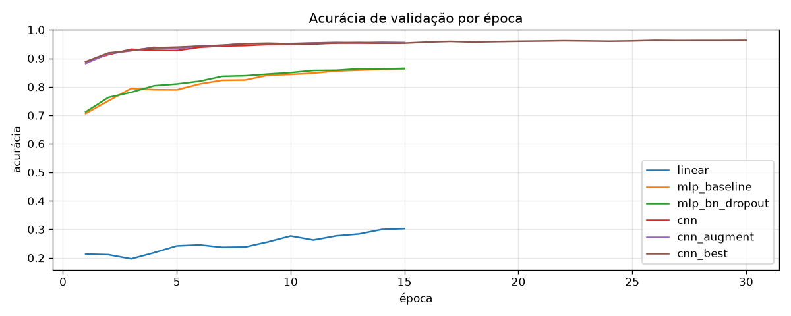
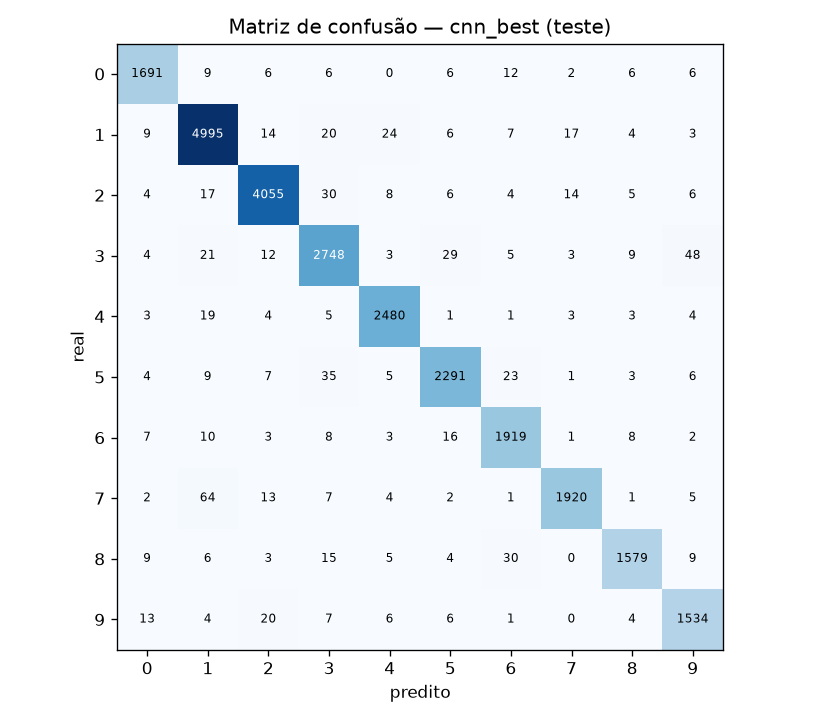
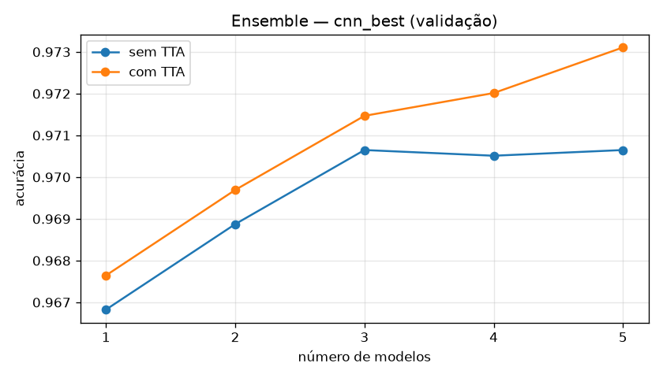
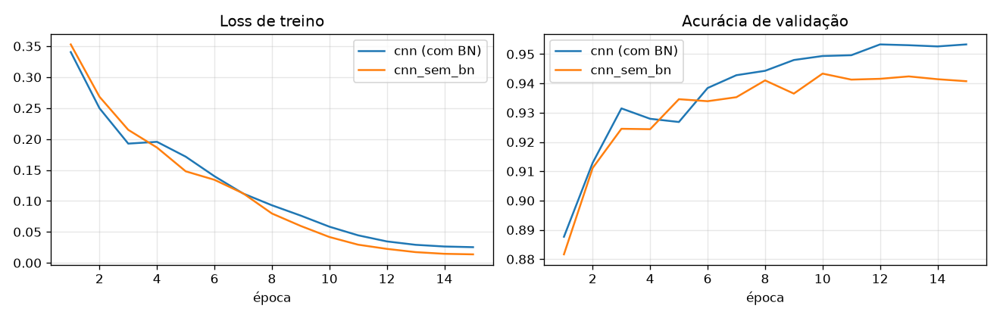
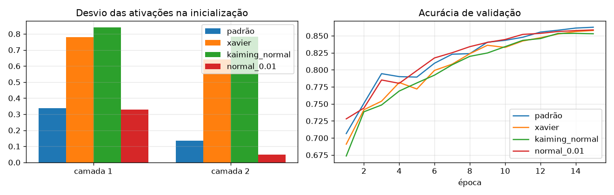
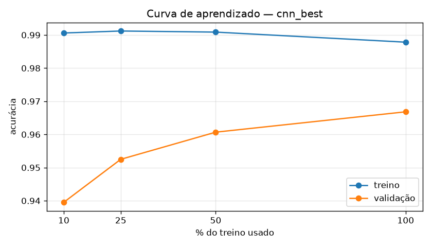

# Classificação de Dígitos — SVHN

Trabalho de Redes Neurais (Samuel, Wilker e Bernardo): classificador linear, MLP, CNN e experimentos
de melhoria no dataset [SVHN](https://pytorch.org/vision/stable/generated/torchvision.datasets.SVHN.html), em PyTorch.

Os termos usados no projeto estão em [GLOSSARY.md](GLOSSARY.md).

**Resultado:** a predição final é um **ensemble de 5 `cnn_best` com TTA**, com **97,31% de acurácia de validação
e 97,63% de teste** (um único `cnn_best`: 96,68% e 97,13%). As 203.856 predições do conjunto adicional estão em
[`SAMUEL_WILKER_BERNARDO_RESULTS.txt`](SAMUEL_WILKER_BERNARDO_RESULTS.txt).

## Estrutura do repositório

| Caminho | Conteúdo |
|---|---|
| [`svhn.ipynb`](svhn.ipynb) | Todo o código: dados, modelos, experimentos, avaliações, modelo final e predições |
| [`GLOSSARY.md`](GLOSSARY.md) | Vocabulário do projeto (conjuntos de dados, experimento, baseline, random subsampling etc.) |
| `requirements.txt` | Dependências para rodar fora do Colab |
| `results/` | Métricas, curvas e tabelas de cada experimento e das avaliações (commitado; funciona como cache) |
| `weights/best.pt` | Pesos do modelo final, com a config e a normalização |
| `weights/ensemble/` | Pesos dos modelos do ensemble: 5 treinados só no treino (escolha) e 4 no `split="train"` inteiro (predição) |
| `SAMUEL_WILKER_BERNARDO_RESULTS.txt` | Predições do conjunto adicional, uma por linha |
| [`tests/check_smoke.py`](tests/check_smoke.py) | Confere as saídas do modo de teste |
| [`.github/workflows/ci.yml`](.github/workflows/ci.yml) | CI: roda o notebook em modo de teste em cada PR |
| `data/` | SVHN baixado e `data/adicional/` com as imagens do professor (ignorado pelo git) |

## Como rodar

O código está todo em [`svhn.ipynb`](svhn.ipynb).

1. No Colab: `Arquivo → Fazer upload de notebook` e escolha o `svhn.ipynb`.
2. `Ambiente de execução → Alterar o tipo de ambiente → GPU`.
3. `Executar tudo`. O dataset é baixado automaticamente.

O SVHN vem do `torchvision`. Se o servidor de Stanford estiver fora do ar, o notebook baixa sozinho os mesmos
dados do espelho oficial no Hugging Face (`ufldl-stanford/svhn`, em parquet), no mesmo formato e na mesma ordem.

Os experimentos já concluídos ficam salvos em `results/` e não são retreinados quando o notebook roda de novo:
com o `results/` e o `weights/` deste repositório, o notebook inteiro roda em poucos minutos. No Colab, envie também
essas duas pastas (ou rode `!git clone https://github.com/SamuelNahas/svhn-classificacao` e `%cd svhn-classificacao` antes de
executar o notebook, para ele achar essas pastas); só com o notebook, tudo é retreinado.
Sem imagens em `data/adicional/`, a última célula pula as predições em vez de falhar. Para não perder
nada se o Colab desconectar, descomente a célula que monta o Google Drive.

Para rodar localmente: `pip install -r requirements.txt jupyter`. Funciona em CUDA, na GPU do Mac (MPS) ou em CPU.
Do zero, a bateria completa levou cerca de 3h30 num Mac M5 (MPS).

## Protocolo

- `split="train"` é dividido em 90% treino e 10% validação, com semente fixa (`SEED = 42`).
- A normalização usa a média e o desvio calculados só no conjunto de treino.
- Cada experimento é avaliado na época com melhor acurácia de **validação**.
- `split="test"` só informa a acurácia; não participa de nenhuma escolha.
- O conjunto adicional do professor só é usado depois que o modelo final está definido.

## Experimentos

Cada experimento muda uma coisa em relação a outro, indicado entre parênteses. A coluna "Aula" indica de
qual material da disciplina veio a ideia.

| # | Experimento | Mudança | Aula |
|---|---|---|---|
| 1 | `linear` | classificador linear 3072 → 10, loss softmax | loss_function |
| 2 | `linear_svm` | loss SVM multiclasse (1) | loss_function |
| 3 | `mlp_baseline` | MLP 512-256, ReLU, Adam lr=1e-3, batch 64 | aula-2 |
| 4 | `mlp_lr_1e-4` | lr 1e-4 (3) | backpropagation |
| 5 | `mlp_lr_1e-2` | lr 1e-2 (3) | backpropagation |
| 6 | `mlp_batch_32` | batch 32 (3) | backpropagation |
| 7 | `mlp_batch_256` | batch 256 (3) | backpropagation |
| 8 | `mlp_sgd` | otimizador SGD no lugar do Adam (5, mesma lr 0,01) | backpropagation |
| 9 | `mlp_sgd_momentum` | + momentum 0,9 (8) | backpropagation |
| 10 | `mlp_100` | uma camada oculta de 100 (3) | aula-2 |
| 11 | `mlp_leaky_relu` | Leaky ReLU (3) | aula-2 |
| 12 | `mlp_tanh` | tanh (3) | aula-2 |
| 13 | `mlp_sigmoid` | sigmóide (3) | aula-2 |
| 14 | `mlp_sem_norm` | sem normalização, só /255 (3) | aula-2 |
| 15 | `mlp_so_media` | só subtrai a média por canal (3) | aula-2 |
| 16 | `mlp_cinza` | tons de cinza, 1024 entradas (3) | aula-2 |
| 17 | `mlp_l2` | regularização L2, λ = 1e-4 (3) | loss_function |
| 18 | `mlp_dropout` | Dropout 0,3 (3) | aula-2 |
| 19 | `mlp_dropout_0.5` | Dropout 0,5 (18) | aula-2 |
| 20 | `mlp_bn_dropout` | + BatchNorm (18) | |
| 21 | `mlp_deep` | camadas 1024-512-256 (20) | |
| 22 | `cnn` | CNN 3 blocos 32/64/128 filtros | |
| 23 | `cnn_augment` | + data augmentation (22) | |
| 24 | `cnn_wide` | filtros 64/128/256 (23) | |
| 25 | `cnn_wd` | weight decay 0.05 (23) | |
| 26 | `cnn_30ep` | 30 épocas (23) | |
| 27 | `cnn_ls` | label smoothing 0.1 (23) | |
| 28 | `cnn_deep` | 3 convoluções por bloco em vez de 2 (23) | |
| 29 | `cnn_cutout` | cutout: quadrado 8×8 zerado em cada imagem do treino (23) | |
| 30 | `cnn_best` | (23) + as mudanças de 24–29 que melhoraram a validação | |

A loss de validação é sempre a entropia cruzada, para comparar todos os experimentos; o `linear_svm` também
reporta a loss SVM (`val_loss_svm`). A loss SVM segue a fórmula da aula:
L_i = Σ_{j≠y_i} max(0, s_j − s_{y_i} + 1).

## Resultados

Acurácias na melhor época de validação (`results/results.csv`). A `cnn_best` combina as variações que
melhoraram a validação em relação à `cnn_augment`: `cnn_wd`, `cnn_30ep`, `cnn_ls`, `cnn_deep` e `cnn_cutout`. A
`cnn_wide` piorou e ficou de fora.

| # | Experimento | Treino | Validação | Teste | Δ val vs. base |
|---|---|---|---|---|---|
| 1 | `linear` | 30,97% | 30,29% | 25,30% | |
| 2 | `linear_svm` | 28,33% | 27,58% | 23,64% | −2,72 (1) |
| 3 | `mlp_baseline` | 95,08% | 86,25% | 82,88% | |
| 4 | `mlp_lr_1e-4` | 91,21% | 86,62% | 84,27% | +0,37 (3) |
| 5 | `mlp_lr_1e-2` | 18,83% | 19,70% | 19,59% | −66,55 (3) |
| 6 | `mlp_batch_32` | 93,52% | 85,76% | 82,73% | −0,49 (3) |
| 7 | `mlp_batch_256` | 94,95% | 86,59% | 83,87% | +0,34 (3) |
| 8 | `mlp_sgd` | 87,27% | 84,66% | 82,33% | +64,96 (5) |
| 9 | `mlp_sgd_momentum` | 95,66% | **86,88%** | 84,24% | +2,23 (8) |
| 10 | `mlp_100` | 89,83% | 85,84% | 83,77% | −0,41 (3) |
| 11 | `mlp_leaky_relu` | 95,78% | 86,80% | 84,12% | +0,55 (3) |
| 12 | `mlp_tanh` | 83,61% | 75,41% | 72,23% | −10,84 (3) |
| 13 | `mlp_sigmoid` | 88,56% | 81,69% | 79,09% | −4,56 (3) |
| 14 | `mlp_sem_norm` | 50,42% | 49,76% | 46,74% | −36,49 (3) |
| 15 | `mlp_so_media` | 95,55% | 86,10% | 83,85% | −0,15 (3) |
| 16 | `mlp_cinza` | 95,19% | 86,66% | 83,65% | +0,41 (3) |
| 17 | `mlp_l2` | 92,86% | 86,31% | 83,64% | +0,05 (3) |
| 18 | `mlp_dropout` | 87,38% | 84,60% | 81,61% | −1,65 (3) |
| 19 | `mlp_dropout_0.5` | 81,86% | 80,26% | 76,79% | −4,34 (18) |
| 20 | `mlp_bn_dropout` | 89,77% | 86,46% | 84,31% | +1,86 (18) |
| 21 | `mlp_deep` | 90,15% | 86,78% | 84,17% | +0,33 (20) |
| 22 | `cnn` | 99,24% | 95,33% | 95,21% | |
| 23 | `cnn_augment` | 97,27% | 95,59% | 96,05% | +0,26 (22) |
| 24 | `cnn_wide` | 97,36% | 95,48% | 96,12% | −0,11 (23) |
| 25 | `cnn_wd` | 97,46% | 95,93% | 96,22% | +0,34 (23) |
| 26 | `cnn_30ep` | 98,54% | 96,01% | 96,37% | +0,42 (23) |
| 27 | `cnn_ls` | 97,31% | 95,81% | 96,51% | +0,22 (23) |
| 28 | `cnn_deep` | 97,88% | 96,03% | 96,37% | +0,44 (23) |
| 29 | `cnn_cutout` | 96,87% | 95,82% | 96,00% | +0,23 (23) |
| 30 | `cnn_best` | 98,78% | **96,68%** | **97,05%** | +1,09 (23) |



**O que os experimentos mostram**

- **Linear → MLP → CNN** é o maior salto: 30% → 87% → 96% na validação. O classificador linear sobre pixels
  crus não separa os dígitos, e a CNN ganha por aproveitar a estrutura espacial da imagem.
- **Taxa de aprendizado:** com Adam, lr 1e-2 diverge (a validação nunca passa de 20%, melhor época = 1); lr 1e-4
  é estável e um pouco melhor que 1e-3. Já o SGD com a mesma lr 1e-2 converge, e o momentum soma +2,2 pontos.
  As curvas estão em `results/taxas_aprendizado.png`.
- **Normalização** é essencial: sem ela a MLP cai para 50%. Só centralizar a média já basta (86,1%), e tons de
  cinza não perdem nada (86,7%), o que indica que a cor quase não ajuda a reconhecer o dígito.
- **Ativações:** ReLU e Leaky ReLU empatam; tanh (75%) e sigmóide (82%) saturam e aprendem pior.
- **Overfitting:** a `mlp_baseline` chega a 95% no treino e 86% na validação, e a `cnn`, a 99% no treino e
  95% na validação. Dropout sozinho reduz essa diferença mas perde acurácia (0,5 é forte demais); com BatchNorm,
  recupera a acurácia (a menor loss de validação entre as MLPs é a da `mlp_deep`). Na CNN, data augmentation, weight decay e label
  smoothing reduzem o overfitting e cada um melhora a validação.
- **Custo:** a `cnn_wide` levou ~2,7 vezes o tempo da `cnn_augment` sem ganhar acurácia; treinar 30 épocas
  rendeu mais que alargar a rede.
- **Profundidade em vez de largura:** a `cnn_deep` (3 convoluções por bloco, +24% de parâmetros) foi a melhor
  mudança isolada (+0,44), enquanto a `cnn_wide` (4× os parâmetros) piorou. O cutout também ajudou (+0,23) e
  reduziu a diferença entre treino e validação. Somando tudo, a `cnn_best` ganhou +0,42 sobre a versão anterior
  (96,26%), que não tinha as duas.

## Avaliações complementares

- **Checagem do gradiente** (backpropagation): `torch.autograd.gradcheck` compara o gradiente do autograd com o
  numérico numa MLP pequena.
- **Baseline kNN** (Lecture 11): kNN nos pixels normalizados, com K ∈ {1, 3, 5, 10, 20} escolhido pela validação
  e teste só no K escolhido. Serve de referência não neural. **Resultado:** K = 20, com 51,56% de validação e
  48,65% de teste, acima do linear e bem abaixo da MLP.
- **Random subsampling** (Lecture 11): os 3 melhores na validação são treinados em mais 5 divisões treino/validação,
  com média ± desvio. A escolha do modelo final continua sendo pela divisão fixa (semente 42). **Resultado:** a
  `cnn_best` fica à frente em todas as divisões e o desvio é pequeno, então a escolha não depende da divisão. A
  `cnn_deep` e a `cnn_30ep` empatam:

  | Modelo | Validação | Teste |
  |---|---|---|
  | `cnn_best` | 96,40% ± 0,16 | 97,12% ± 0,09 |
  | `cnn_deep` | 95,76% ± 0,19 | 96,45% ± 0,12 |
  | `cnn_30ep` | 95,78% ± 0,14 | 96,35% ± 0,07 |

- **Análise de erros do modelo final** (Lecture 11): matriz de confusão no teste, precisão/recall/F1 por dígito e
  exemplos de erros, feitos com o método das predições (ensemble de 5 + TTA). **Resultado:** F1 entre 0,968
  (dígito 9) e 0,983 (dígito 4); as confusões mais comuns são 7 → 1 (45 imagens), 3 → 9 (34) e 5 → 3 (21).

  

Saídas em `results/`:
- `results.csv`: loss e acurácia de treino e validação, acurácia de teste e a melhor época de cada experimento.
- `<experimento>.png`: curvas de loss e acurácia.
- `comparacao_validacao.png`: acurácia de validação dos principais modelos.
- `taxas_aprendizado.png`: loss de treino e validação com lr 1e-4, 1e-3 e 1e-2.
- `knn.csv`: acurácia de validação por K e de teste no K escolhido.
- `subsampling.csv` e `subsampling/`: média ± desvio dos 3 melhores em 5 divisões.
- `confusao.png`, `metricas_por_classe.csv` e `erros.png`: análise de erros do modelo final.
- `tta_ensemble.csv` e `ensemble.png`: validação e teste do ensemble de 1 a 5 modelos, com e sem TTA.
- `final_predicao.json`: método usado nas predições e a sua acurácia de teste.

## Modelo final

No fim do notebook, o experimento com a **maior acurácia de validação** é retreinado com todo o
`split="train"` (treino + validação), com a mesma config e semente, parando na época da sua melhor validação
(mesmo agendamento de LR do experimento).

- `weights/best.pt`: pesos, config, média e desvio da normalização (usados na predição).
- `results/final.json`: arquitetura, número de parâmetros, acurácia de validação do experimento e acurácia de teste.

Se `weights/best.pt` já existe com a mesma config, ele é carregado em vez de retreinado. Ao recarregar, o
notebook confere que os pesos salvos reproduzem a acurácia de teste.

**Modelo escolhido:** `cnn_best`, a CNN de 3 blocos (32/64/128 filtros, três convoluções com BatchNorm e ReLU
por bloco, Dropout 0,3, 1.009.226 parâmetros) com data augmentation e cutout, AdamW (lr 1e-3, weight decay
0,05), label smoothing 0,1, batch 64 e LR cosseno em 30 épocas. Retreinada até a época 24 com todo o
`split="train"`, ficou com **97,13% no teste**.

### TTA e ensemble (#17)

Duas formas de melhorar a predição sem mudar o treino, escolhidas **pela validação** com modelos treinados só
no treino:
- **TTA:** média do softmax da imagem e de 4 cópias deslocadas ±2 px (sem espelhamento: dígito espelhado é
  outro símbolo).
- **Ensemble:** a `cnn_best` treinada com as sementes 42 a 46 na mesma divisão; o ensemble de *k* é a média do
  softmax dos *k* primeiros, de 1 a 5.

| Modelos | Validação | Validação com TTA | Teste | Teste com TTA |
|---|---|---|---|---|
| 1 | 96,68% | 96,76% | 97,05% | 97,11% |
| 2 | 96,89% | 96,97% | 97,40% | 97,47% |
| 3 | 97,06% | 97,15% | 97,46% | 97,45% |
| 4 | 97,05% | 97,20% | 97,46% | 97,50% |
| 5 | 97,06% | **97,31%** | 97,51% | **97,57%** |



O TTA ajuda em todos os tamanhos. Sem TTA, o ensemble estabiliza em 3 modelos; com TTA, ainda sobe até 5, mas
de 3 para 5 o ganho é de 0,16 ponto (~12 das 7.325 imagens de validação), perto do desvio entre divisões
(±0,16). Mais modelos devem render pouco, e cada um custa ~27 min (validação + retreino).

Escolhido: **ensemble de 5 + TTA**. Os 5 modelos são retreinados em todo o `split="train"` (o da semente 42 é o
`weights/best.pt`; os outros ficam em `weights/ensemble/`), e o ensemble final tem **97,63% no teste**, contra
96,85% do modelo final anterior: o erro cai cerca de 25%.

## Predições do conjunto adicional

Depois do modelo final, o notebook classifica as imagens do professor e grava
`SAMUEL_WILKER_BERNARDO_RESULTS.txt` com o método escolhido acima (ensemble de 5 + TTA): uma predição (0 a 9) por linha, na ordem numérica do nome dos arquivos.
Antes de rodar, coloque as imagens (`000000.png`, `000001.png`, ...) em `data/adicional/`: no Colab, faça
upload e descompacte lá; localmente, basta um link, por exemplo `ln -s ~/Downloads/images data/adicional`.

O conjunto tem 203.856 imagens PNG 32×32, sem rótulos, e as classes previstas ficam bem equilibradas (entre
20.106 e 21.271 imagens por dígito). Sem rótulos não há acurácia; a melhor referência é o teste, 97,63%. Em
relação às predições do modelo final anterior, 3.253 imagens (1,6%) mudaram de classe.

## Experimentos extras (#14)

Ideias fora do escopo da entrega, registradas na #14. Elas ficam numa seção própria do notebook, com cache em
`results/extras/` e tabela em `results/extras.csv`, e **não entram** na tabela principal, no random subsampling
nem na escolha do modelo final. Cada uma é comparada com a sua base; rodar as 7 levou ~22 min no M5. A curva
de aprendizado acompanha o modelo final, então foi refeita com a `cnn_best` atual.

| Extra | Base | Treino | Validação | Teste | Δ val vs. base |
|---|---|---|---|---|---|
| `cnn_sem_bn` | `cnn` | 98,92% | 94,33% | 94,71% | −1,00 |
| `mlp_init_xavier` | `mlp_baseline` | 94,23% | 85,77% | 82,96% | −0,48 |
| `mlp_init_kaiming_normal` | `mlp_baseline` | 93,78% | 85,35% | 82,30% | −0,90 |
| `mlp_init_normal_0.01` | `mlp_baseline` | 94,15% | 85,86% | 83,28% | −0,40 |
| `cnn_best_10pct` | `cnn_best` | 99,06% | 93,95% | 94,04% | −2,73 |
| `cnn_best_25pct` | `cnn_best` | 99,12% | 95,25% | 95,79% | −1,43 |
| `cnn_best_50pct` | `cnn_best` | 99,09% | 96,07% | 96,61% | −0,61 |

- **CNN sem BatchNorm:** a loss de treino cai no mesmo ritmo (até um pouco mais baixa no fim), mas a validação
  estaciona em ~94,3% contra 95,3% com BN. Aqui o BN ajuda mais na generalização do que na velocidade de
  convergência: sem ele, a diferença entre treino e validação sobe de 3,9 para 4,6 pontos.

  

- **Inicialização dos pesos (MLP 512-256):** cada variação reinicializa os pesos de todas as camadas lineares
  (inclusive a de saída) e zera os bias; o padrão do PyTorch usa bias uniformes. Na inicialização, o desvio das ativações muda muito. Xavier e Kaiming
  normal mantêm o sinal (0,78 → 0,64 e 0,84 → 0,78 nas duas camadas ocultas), o padrão do PyTorch o reduz
  (0,34 → 0,14) e N(0; 0,01) quase o apaga na segunda camada (0,33 → 0,05). Nenhuma unidade nasce morta (0% de
  ReLUs que não ativam para nenhuma imagem do lote). Mesmo assim, depois de 15 épocas as quatro ficam a menos de
  1 ponto entre si: com só duas camadas ocultas e o Adam, que ajusta o passo de cada peso, a escala inicial pesa
  pouco. O efeito deve aparecer em redes mais profundas ou com SGD.

  

- **Curva de aprendizado da `cnn_best`:** a validação sobe de 94,0% (10% do treino) para 95,3% (25%), 96,1%
  (50%) e 96,7% (100%), enquanto o treino fica entre 98,8% e 99,1% em todos. Os ganhos de cada passo diminuem
  (+1,3 de 10% para 25%, +0,8 de 25% para 50% e +0,6 de 50% para 100%), mas ainda não zeraram: mais dados
  provavelmente ainda ajudariam. A diferença entre treino e validação diminui de 5,1 para 2,1 pontos.
  Ressalva: todas as frações treinam as mesmas 30 épocas, então a de 10% faz 10 vezes menos passos de
  otimização; parte da queda pode vir disso, e não só de ter menos dados.

  

## Decisões de implementação

- **Dados na GPU:** o dataset inteiro (~300 MB em `uint8`) vai para a GPU e os batches são montados lá, sem
  `DataLoader`. O data augmentation (rotação ±8°, escala ±10%, translação ±8%) também roda na GPU, por imagem.
- **Reprodutibilidade:** semente fixa (`SEED = 42`) em cada treino e cuDNN determinístico.
- **Cache por config:** cada experimento salva em `results/<nome>.json` a config completa (arquitetura,
  hiperparâmetros, épocas, semente). Ao rodar de novo, só é carregado se a config for idêntica; qualquer mudança
  retreina. Por isso, acrescentar um valor padrão novo em `full_config` retreina todos os experimentos.
- **Configs como dados:** experimentos são descritos por `arch` + `arch_args` (sem lambdas), para poderem ser
  comparados com o salvo. As configs também guardam o pré-processamento (`norm`, `gray`), a loss (`loss`, `l2`)
  e o otimizador (`optimizer`, `momentum`).
- **`cnn_best` automático:** combina as variações de CNN (24–27) que superaram a `cnn_augment` na validação; se
  nenhuma superar, reaproveita a `cnn_augment` sem retreinar.
- **Divisões reutilizáveis:** `make_split(seed)` e o cache genérico `cached_train` permitem treinar a mesma config
  em outras divisões (random subsampling).
- **Checkpoint seguro:** `weights/best.pt` é gravado com troca atômica; se estiver ausente ou corrompido, o modelo é retreinado.
- **Métricas comparáveis:** a loss de validação é sempre a entropia cruzada pura (mesmo com label smoothing ou loss
  SVM), e as métricas de treino são medidas em modo de avaliação (sem dropout nem augmentation).
- **Download resiliente:** se o `torchvision` não conseguir baixar o SVHN, os mesmos dados vêm do espelho no
  Hugging Face.

## Testes e CI

O notebook tem um modo de teste, ligado por `SVHN_SMOKE=1`: usa poucos dados aleatórios no formato do SVHN (500 de treino e 200 de teste, sem
baixar o dataset), 2 épocas e grava tudo em `smoke/` (apagado a cada execução, para sempre treinar de novo), sem tocar em
`results/` nem em `weights/`. Sem a
variável, o notebook roda normalmente.

O GitHub Actions ([`.github/workflows/ci.yml`](.github/workflows/ci.yml)) executa o notebook inteiro nesse modo
em cada PR e em cada push na `main` (exceto quando só mudam arquivos `.md`), e [`tests/check_smoke.py`](tests/check_smoke.py) confere as saídas:
30 experimentos, acurácias entre 0 e 1, losses positivas, curvas, `final.json`, pesos salvos, kNN,
random subsampling, análise de erros, os 7 experimentos extras, a tabela de TTA e ensemble e o arquivo de predições (uma linha por imagem, só dígitos). O notebook
executado fica disponível como artefato do job.

Para rodar localmente (cerca de 1 min):

```bash
pip install -r requirements.txt nbconvert ipykernel
SVHN_SMOKE=1 jupyter nbconvert --to notebook --execute svhn.ipynb --output smoke-executed.ipynb
python tests/check_smoke.py smoke
```

## Organização do trabalho

- **Board:** [Trabalho SVHN](https://github.com/users/SamuelNahas/projects/2), com as colunas Backlog → Fazendo →
  Verificação → Pronto.
- **Issues:** a [#1](../../issues/1) reúne as decisões do trabalho; cada entregável é uma sub-issue:

  | Issue | Entregável | Status |
  |---|---|---|
  | [#2](../../issues/2) | Notebook + experimentos | Concluída (PR #6) |
  | [#3](../../issues/3) | Modelo final + pesos | Em revisão (PR #7) |
  | [#10](../../issues/10) | CI: teste rápido do notebook | Em revisão (PR #12) |
  | [#13](../../issues/13) | Experimentos e avaliações pt2 + resultados | Em revisão (PR #15) |
  | [#4](../../issues/4) | Predições do conjunto adicional | Em revisão (PR #16) |
  | [#8](../../issues/8) | Atualizar este README | Em revisão (PR #9) |
  | [#5](../../issues/5) | Relatório em LaTeX | A fazer |
  | [#11](../../issues/11) | Validação do arquivo de predições | A fazer |
  | [#17](../../issues/17) | Experimentos pt3: CNN mais profunda, cutout, TTA e ensemble | Em revisão (PR #21) |
  | [#14](../../issues/14) | Ideias de experimentos futuros (fora do escopo) | Em revisão (PR #19) |

- **Branches:** uma por issue (`<número>-<descrição>`), com PR que fecha a issue. Quando uma issue depende de outra
  ainda aberta, o PR é empilhado sobre a branch da anterior. Pilha atual: #7 → #12 → #15 → #16 → #9.
- **Commits:** só os integrantes do grupo constam como autores.

## Histórico de mudanças

### PR #6 — Notebook + experimentos (#2)
- `svhn.ipynb` autocontido para o Colab substitui o `svhn.py`.
- 15 experimentos, uma mudança por vez; divisão 90/10 fixa, normalização só no treino, teste avaliado na melhor época de validação.
- Revisão aplicada: cache por config, cuDNN determinístico, loss e acertos acumulados na GPU, média e desvio numa só passada, `cnn_best` sem retreino desnecessário.
- `GLOSSARY.md` criado.

### PR #7 — Modelo final (#3)
- `train_final` retreina o melhor experimento em treino + validação, parando na melhor época com o mesmo agendamento de LR.
- `weights/best.pt` com pesos, config e normalização; carregado se já existir com a mesma config.
- Conferência de que os pesos recarregados reproduzem a acurácia de teste; `results/final.json` para o relatório.
- **Correção:** os acumuladores de loss e acertos apontavam para o mesmo tensor e geravam acurácias acima de 1. O commit
  entrou depois do merge do PR #6, então a correção chega à `main` por este PR.

### PR #12 — CI (#10)
- Modo de teste `SVHN_SMOKE=1`: dados aleatórios no formato do SVHN, 2 épocas e saídas em `smoke/`, sem cache.
- GitHub Actions roda o notebook nesse modo em cada PR (PyTorch CPU) e `tests/check_smoke.py` confere as saídas.

### PR #15 — Experimentos e avaliações pt2 (#13)
- 13 experimentos novos ligados às aulas (de 15 para 28): loss SVM, L2, ativações, rede 3072-100-10,
  normalizações, tons de cinza, Dropout 0,5, batch 32, SGD e SGD com momentum.
- Avaliações novas: checagem do gradiente, baseline kNN, random subsampling, análise de erros e gráfico das
  taxas de aprendizado.
- Espelho do Hugging Face quando o download de Stanford falha (o servidor ficou fora do ar durante a bateria).
- `results/` e `weights/best.pt` da bateria completa commitados.

### PR #16 — Predições do conjunto adicional (#4)
- Célula final lê os PNGs de `data/adicional/` em ordem numérica e grava `SAMUEL_WILKER_BERNARDO_RESULTS.txt`.
- O modo de teste gera PNGs aleatórios e o CI confere uma linha por imagem, só dígitos de 0 a 9.

### PR #9 — README (#8)
- Estrutura do repositório, resultados com análise, decisões de implementação, organização do trabalho e este histórico.

### PR #19 — Experimentos extras (#14)
- CNN sem BatchNorm, inicialização dos pesos da MLP e curva de aprendizado do modelo final, em seção própria
  (`results/extras/`), sem mudar a tabela principal nem o modelo final.
- `batches()` não gera mais um último lote de 1 imagem.

### PR #21 — Experimentos pt3 (#17)
- `cnn_deep` (3 convoluções por bloco) e `cnn_cutout` entram nas variações da CNN e na `cnn_best`, que sobe para
  96,68% de validação e vira o novo modelo final.
- TTA e ensemble de 1 a 5 modelos, escolhidos pela validação: ensemble de 5 + TTA, com 97,63% no teste.
- `SAMUEL_WILKER_BERNARDO_RESULTS.txt` e `weights/` regenerados com o método escolhido.

## Entregáveis

- [x] Código: `svhn.ipynb`
- [x] Pesos: `weights/best.pt`
- [x] `SAMUEL_WILKER_BERNARDO_RESULTS.txt`
- [ ] Relatório em PDF (#5)

## Próximos passos

1. Escrever o relatório com os números deste README e de `results/` (#5).
2. Validar o formato do `RESULTS.txt` com um script próprio e no CI (#11).
3. Experimentos pt4 nas DGX Spark (#20), em andamento: estado, resultados parciais e pendências em
   [`dgx/README.md`](dgx/README.md).
